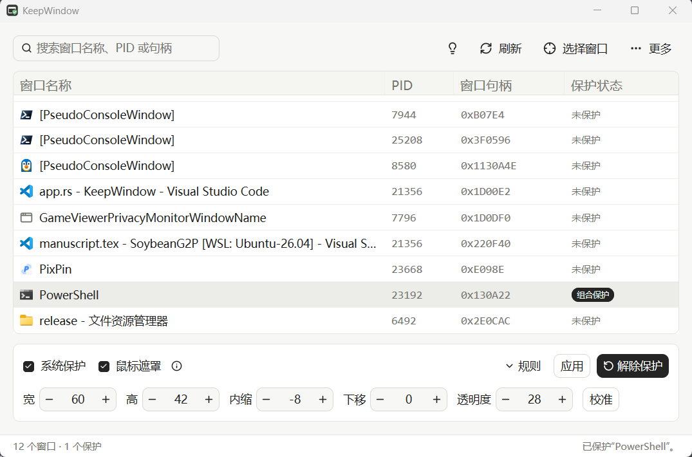

# KeepWindow

English documentation: [README.en.md](README.en.md).

支持简体中文和 English，在 **更多 → 语言** 点击切换，即时生效并保存到配置。未设置时使用 Windows UI 语言；其他语言回退为简体中文。配置版本继续使用 2，旧配置无需修改。

翻译资源位于 `locales/zh-CN.json` 和 `locales/en-US.json`，构建时验证键和命名占位符一致。程序内置两种语言，可单独运行；可执行文件旁同名资源存在时优先加载，损坏或不完整时使用内置中文。日志保留事件产生时的语言。

[](https://github.com/NeterAlex/KeepWindow/actions/workflows/ci.yml)
[](https://github.com/NeterAlex/KeepWindow/releases)
[](LICENSE)

KeepWindow 是一个 Windows 窗口防误关闭工具。它通过系统菜单保护标准标题栏，也可以用鼠标遮罩拦截自绘标题栏的关闭按钮。

<p align="center">
  <a href="assets/main_window_screenshot.png">
    
  </a>
</p>

## 功能

- **系统关闭保护**：禁用目标窗口系统菜单中的“关闭”项。
- **鼠标遮罩**：覆盖自绘标题栏关闭按钮，支持 DPI 缩放、移动、调整大小和校准。
- **应用规则**：按程序路径、窗口类名和可选标题关键词自动匹配窗口。
- **后台驻留**：隐藏主界面后继续保护，可从系统托盘返回或退出。
- **安全恢复**：记录保护前的状态；异常退出后，重新启动时恢复身份匹配的窗口。
- **准星选窗与开机启动**：快速定位窗口，也可选择登录后后台运行。

## 安装

从 [Releases](https://github.com/NeterAlex/KeepWindow/releases) 下载最新的 Windows x64 压缩包，解压后运行 `keep-window.exe`。

运行要求：Windows 10 1703 或更新版本，x64。目标程序以管理员身份运行时，KeepWindow 也可能需要以管理员身份运行。

## 快速使用

1. 在窗口列表中选择目标，或点击“选择窗口”后单击目标窗口。
2. 标准标题栏启用“系统保护”；自绘标题栏启用“鼠标遮罩”，也可以同时启用。
3. 点击“开启保护”。使用鼠标遮罩时，确认覆盖区域对准关闭按钮，必要时点击“校准”。
4. 修改参数后点击“应用”；完成后点击“解除保护”恢复窗口。

关闭或最小化主界面、按 `Alt+F4` 都只会隐藏 KeepWindow，保护会继续运行。也可以直接启动到后台：

```powershell
.\keep-window.exe --background
```

## 应用规则

在选中窗口并设置保护方式后，展开“规则”并保存即可。规则支持以下匹配条件：

- 完整程序路径：不区分大小写。
- 窗口类名：精确匹配。
- 标题关键词：可选，不区分大小写；多条规则同时命中时，带标题条件的规则优先。

规则默认不自动保护新窗口，可在“更多 → 应用规则管理”中编辑、启用、禁用或删除。

配置文件位于：

```text
%LOCALAPPDATA%\KeepWindow\config.json
```

## 恢复与日志

系统关闭项修改前会写入恢复记录。KeepWindow 正常退出时清理记录；异常退出后再次启动，会校验窗口句柄、进程身份、完整路径和窗口属性，只恢复能够安全匹配的窗口。

无法安全匹配的记录会保留为残留文件，损坏的恢复记录会先备份。恢复失败项会保留，供下一次启动重试。鼠标遮罩随 KeepWindow 进程退出而消失，不参与恢复。

后台启动错误记录在：

```text
%LOCALAPPDATA%\KeepWindow\startup-error.log
```

## 限制

- 系统关闭保护依赖目标程序遵守 Windows 系统菜单状态，自绘标题栏可能绕过它。
- 鼠标遮罩只拦截覆盖区域内的鼠标点击，并且仅在目标窗口可见且位于前台时显示。
- `Alt+F4`、程序自己的退出命令、自定义快捷键、直接发送关闭消息或结束进程不受鼠标遮罩保护。
- 目标窗口已关闭、重建或无法验证身份时，恢复操作会跳过该窗口。

## 从源码构建

需要 Rust stable MSVC 工具链、Visual Studio Build Tools 的“使用 C++ 的桌面开发”组件和 Windows SDK。

```powershell
git clone https://github.com/NeterAlex/KeepWindow.git
cd KeepWindow
cargo build --release
.\target\release\keep-window.exe
```

提交前建议运行：

```powershell
cargo fmt --check
cargo clippy --locked --all-targets --all-features -- -D warnings
cargo test --locked --all-targets --all-features -- --test-threads=1
```

## 许可证

[MIT License](LICENSE)

交互思路参考 [PettterWang/NOCLOSE](https://github.com/PettterWang/NOCLOSE)。
